# Apex Shield Roofing — Production-Ready Whop Websites Template

[](https://apexshield-roofing-pro.whop.app)
[](https://docs.whop.com/elements)
[](./test/roofing-template.test.ts)

A production-ready website template for US roofing companies built for **Whop Websites** and deployed live on Cloudflare Workers. Engineered to demonstrate Whop's end-to-end commerce capabilities to roofing and high-ticket service contractors.

🌐 **Live whop.app URL:** [https://apexshield-roofing-pro.whop.app](https://apexshield-roofing-pro.whop.app)  
🌐 **Hosted Domain:** [https://apexshield-roofing-pro.whop.site](https://apexshield-roofing-pro.whop.site)  
🏢 **Whop App ID:** `app_Y4z44ib7PcAbXE`  
💼 **Whop Business Account:** `biz_zBWnpz7MPDz46s`

---

## ⚡ The High-Ticket Workflow: Deposit → Job → Final Invoice

Roofing is a high-ticket vertical ($8,000–$25,000+ per replacement). This template demonstrates the complete lifecycle without ever leaving the Whop payments infrastructure:

```mermaid
flowchart LR
    A["Homeowner\nInteractive Funnel"] -->|POST /api/v1/leads| B["Whop Leads CRM\nLead Ingested"]
    B --> C["Drone Inspection\n$149 Plan"]
    C --> D["Job Commitment\n$500 Deposit"]
    D -->|Whop Setup Intent\nsetupFutureUsage: off_session| E["Vaulted Card-on-File\npmt_visa_4242"]
    E --> F["Tear-off & Roof\nReplacement Execution"]
    F -->|Walkthrough Sign-off| G["Whop Invoices API\nPOST /api/v1/invoices"]
    G -->|Auto-Charge Vault| H["$9,850 Final Settlement\n0% Chargebacks"]
```



1. **Lead Ingestion:** "Request an Estimate" 3-step interactive funnel capturing roof material, square footage, urgency, and address, dispatches to the **Whop Leads API** (`POST /api/v1/leads`).
2. **Immediate Diagnostics:** Instant checkout for a **$149 32-Point Drone & Hazard Inspection**.
3. **Crew Commitment Deposit:** Homeowner pays a **$500 Project Commitment Deposit** via Whop Payment Elements. Whop creates a Setup Intent (`setupFutureUsage: 'off_session'`), saving the payment method securely on file.
4. **Post-Job Final Invoice:** Upon walkthrough approval, the contractor triggers post-job billing ($9,850 default balance) via the **Whop Invoices API** (`POST /api/v1/invoices`), charging the vaulted card automatically or dispatching a hosted payment link.

---

## 🛡️ Key Features

### 1. Whop Payment Elements (`@whop/elements-react`)
- **Zero custom card forms or Stripe/PayPal:** Checkout runs exclusively on Whop Elements.
- `<ExpressCheckoutElement />`: Instant one-touch Apple Pay & Google Pay.
- `<PaymentElement />`: Native card processing with auto-surfaced POS financing (Klarna, Splitit, Afterpay, Affirm) for high-ticket jobs.
- `<BrandingElement />`: Required "Powered by Whop" badge.

### 2. Live Contractor Pitch Simulation HUD
- Floating back-office cockpit demonstrating the contractor experience to roofing company executives.
- Real-time leads counter reflecting incoming estimate submissions.
- Vaulted Card-on-File viewer showing active off-session chargeable tokens (`pmt_visa_4242`).
- Final invoice trigger supporting one-click settlement upon walkthrough sign-off.

### 3. Verifiable `whop.track` Pixel Analytics
- Custom pixel events dispatched at critical conversion steps:
  - `estimate_requested`: Fired on lead funnel completion.
  - `service_viewed`: Fired on inspection plan or service detail views.
  - `deposit_started`: Fired when opening deposit checkout with card-on-file vaulting.
- Built-in on-screen **whop.track Inspector HUD** for real-time telemetry inspection.

### 4. Zero-Code Re-branding (`roofing.config.ts`)
Swap the company name, phone, license, emergency hours, covered zip codes, and pricing in [`roofing.config.ts`](./roofing.config.ts) without modifying any UI or structural code.

---

## 📦 Configured Whop Plans

| Plan | Whop Plan ID | Price | Type | Purpose |
| :--- | :--- | :--- | :--- | :--- |
| **32-Point Drone & Hazard Inspection** | `plan_QUzjUa4spCzgP` | **$149** | One-Time Service | High-res 4K aerial drone scan & insurance claim diagnostic (credited 100% to approved repairs). |
| **Project Commitment & Crew Slot Deposit** | `plan_UCg8s2a6PgZXA` | **$500** | Project Deposit | Locks 5-day installation slot, orders materials, and vaults card-on-file for final balance settlement. |
| **Emergency Leak Stop & Flashing Seal** | `plan_iWaKK4ioYaw9H` | **$2,499** | Flat-Rate Service | Full chimney/valley flashing rebuild and 2-square shingle patch with 5-year workmanship warranty. |

---

## 🚀 Quickstart

### Prerequisites
- [Bun](https://bun.sh/) (v1.2+) or Node.js (v20+)
- [Whop CLI](https://docs.whop.com/developer/cli) (`@whop/cli`)

### Installation & Local Development

```bash
# Clone the repository
git clone https://github.com/roshithragh-byte/apex-shield-roofing.git
cd apex-shield-roofing

# Install dependencies
bun install

# Run local dev server
bun dev
```

### Running Automated Verification Tests

```bash
bun test
```

### Building for Whop Websites Hosting

```bash
bun run build
```

### Deploying to Live Whop.site

```bash
# Authenticate with Whop CLI
npx @whop/cli auth login

# Deploy build to production
npx @whop/cli apps deploy --app app_Y4z44ib7PcAbXE
```

---

## 📂 Project Structure

```text
├── roofing.config.ts          # Centralized configuration schema (pricing, company, zips)
├── src/
│   ├── components/
│   │   ├── Navbar.tsx         # Emergency banner, logo, click-to-call, Pitch Mode toggle
│   │   ├── Hero.tsx           # Value proposition, trust badges, emergency CTA
│   │   ├── ZipChecker.tsx     # Live Central Texas zip code availability checker
│   │   ├── Services.tsx       # Core roofing services & financing breakdown
│   │   ├── Plans.tsx          # The 3 Whop plans ($149, $500, $2,499)
│   │   ├── FinancingSection.tsx # Monthly payment calculator & BNPL explainer
│   │   ├── EstimateFunnel.tsx # 3-step diagnostic form wired to Whop Leads API
│   │   ├── ReviewsTrust.tsx   # Verified homeowner reviews & manufacturer warranties
│   │   ├── Footer.tsx         # Contact info, service zips, license disclosures
│   │   ├── WhopCheckoutModal.tsx # Whop Elements checkout modal with card-on-file
│   │   ├── RooferPitchBar.tsx # Contractor operations cockpit HUD
│   │   └── EventInspector.tsx # Real-time whop.track pixel HUD
│   ├── context/
│   │   └── PitchDemoContext.tsx # Shared state for leads, vaulted cards, invoices
│   ├── routes/
│   │   ├── __root.tsx         # TanStack Start root document & meta headers
│   │   └── index.tsx          # Homepage route mounting <AppContent />
│   ├── router.tsx             # TanStack router initialization
│   ├── styles.css             # Tailwind v4 styles & custom scrollbars
│   └── utils/
│       ├── tracking.ts        # Defensive whop.track analytics dispatcher
│       └── whopClient.ts      # Client for Whop Leads & Invoices APIs
├── test/
│   └── roofing-template.test.ts # 9 automated unit/integration tests
├── wrangler.jsonc             # Cloudflare Workers compatibility config
└── whop.app.json              # Whop app linkage metadata
```

---

## 📄 License

MIT License. Free to use as a template for pitching and building contractor websites on Whop.
