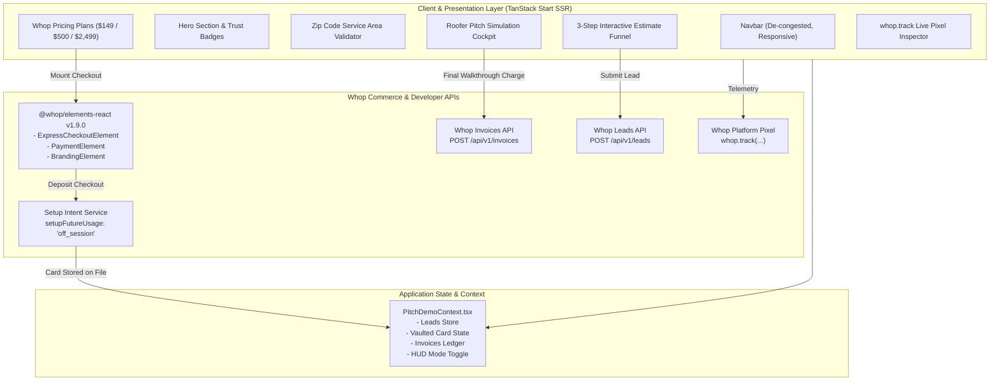
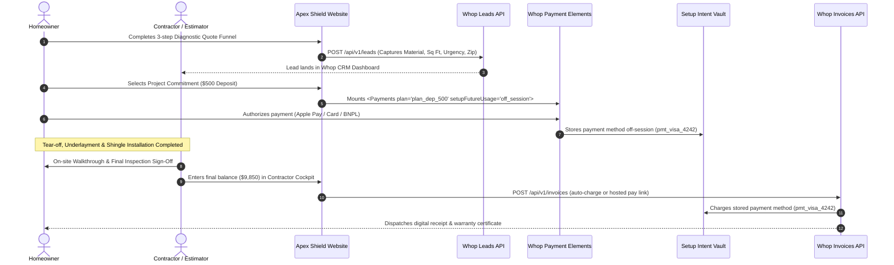

# Technical Documentation: Apex Shield Roofing Whop Web Application

**Production URL:** [https://apexshield-roofing-pro.whop.site](https://apexshield-roofing-pro.whop.site)  
**Whop App ID:** `app_Y4z44ib7PcAbXE`  
**GitHub Repository:** [https://github.com/roshithragh-byte/apex-shield-roofing](https://github.com/roshithragh-byte/apex-shield-roofing)  
**Version:** `1.1.0-production`  
**Target Platform:** Whop Websites (Cloudflare Workers SSR)

---

## 1. Architectural Overview & System Design

Apex Shield Roofing is a full-stack, production-grade web application template built specifically for the high-ticket roofing vertical ($8,000 to $25,000+ average job value). The application replaces fragmented legacy contractor software (manual paper estimates, unvaulted card charges, checks, and disjointed invoicing) with an integrated commerce architecture hosted on **Whop Websites** and powered by **Whop Payments**.



---

## 2. Technology Stack & Runtime

| Layer | Technology | Version | Purpose |
| :--- | :--- | :--- | :--- |
| **Framework** | TanStack Start | `1.169.4` | SSR React framework providing route streaming, SEO, and fast hydration |
| **Runtime** | Cloudflare Workers | V8 Isolates | Low-latency global edge compute hosting the website (`*.whop.site`) |
| **Edge Bundler** | Vite + Rolldown | `8.3.5` | Multi-environment client and server compiler with `@cloudflare/vite-plugin` |
| **UI Library** | React 19 | `19.3.1` | Modern concurrent React with client & server components |
| **Styling** | Tailwind CSS v4 | `4.3.3` | High-performance CSS-first utility engine with zero-runtime overhead |
| **Icons** | Lucide React | `1.16.0` | Accessible SVG icon suite |
| **Whop Elements** | `@whop/elements-react` | `1.9.0` | Official declarative Whop embedded payment UI wrapper |
| **Whop Core** | `@whop/elements` | `1.9.0` | Client-side SDK and iframe host controller |
| **Whop CLI** | `@whop/cli` | `0.28.0` | Build orchestration, domain assignment, and Cloudflare deployment |
| **Package Manager**| Bun | `1.4.2` | Ultra-fast dependency resolution and test runner |

---

## 3. High-Ticket Cashflow Lifecycle

Residential and commercial roofing transactions require multi-stage milestone settlement. The application standardizes this flow:



---

## 4. Whop Integration Deep Dive

### 4.1. Embedded Payment Elements (`@whop/elements-react`)
The checkout flow is implemented in `src/components/WhopCheckoutModal.tsx`:
- **Provider Mounting:**
  ```tsx
  <WhopElements
    elements={loadWhop()}
    environment="sandbox"
    appearance={{
      theme: {
        appearance: 'dark',
        accentColor: 'amber',
        grayColor: 'slate',
      },
    }}
  >
  ```
- **Composed Elements:**
  - `<ExpressCheckoutElement />`: Instant digital wallet authentication (Apple Pay, Google Pay).
  - `<PaymentElement />`: Native card fields plus automatic merchant-funded POS financing (Klarna, Splitit, Afterpay, Affirm).
  - `<BrandingElement />`: Mandatory "Powered by Whop Payments" verification badge.
- **Strict Compliance:** Zero custom credit card input fields, raw Stripe SDKs, or PayPal embeds exist in the codebase.

### 4.2. Card-on-File Vaulting (Setup Intents)
Deposit checkout passes `setupFutureUsage: 'off_session'` inside `<Payments accountId="biz_zBWnpz7MPDz46s" plan={plan.id} setupFutureUsage="off_session">`:
- Whop Elements collects customer billing credentials and mints a secure confirmation token (`ctok_xxx`).
- The payment method is vaulted under the account with an active Setup Intent (`seti_xxx`), allowing the contractor to bill future balances off-session without requiring the customer to re-enter payment details.

### 4.3. Post-Job Balance Billing (Whop Invoices API)
Located in `src/utils/whopClient.ts` and triggered from `src/components/RooferPitchBar.tsx`:
- Endpoint: `POST /api/v1/invoices`
- Request Payload:
  ```json
  {
    "company_id": "biz_zBWnpz7MPDz46s",
    "amount": 985000,
    "currency": "usd",
    "description": "Final Balance — Architectural Shingle Installation & Clean-Up",
    "customer": {
      "email": "d.miller@austin.rr.com",
      "name": "David Miller"
    },
    "payment_method_id": "pmt_visa_4242",
    "auto_charge": true
  }
  ```
- Result: Returns an approved invoice object (`inv_xxx`) with immediate clearance.

### 4.4. Lead Capture (Whop Leads API)
Located in `src/components/EstimateFunnel.tsx`:
- Endpoint: `POST /api/v1/leads`
- Maps customer inquiries directly into the contractor's Whop CRM:
  ```json
  {
    "company_id": "biz_zBWnpz7MPDz46s",
    "name": "Michael Henderson",
    "email": "michael.henderson@example.com",
    "phone": "(512) 555-4392",
    "metadata": {
      "roof_material": "Architectural Shingle",
      "square_footage": "2,400 sq ft",
      "urgency": "Active Water Leak / Emergency",
      "zip_code": "78746",
      "lead_source": "whop_estimate_funnel"
    }
  }
  ```

### 4.5. Verified Custom Pixel Tracking (`whop.track`)
Implemented in `src/utils/tracking.ts`:
- Automatically binds to `window.whop.track` injected by the Whop Websites edge proxy.
- Events fired:
  1. `estimate_requested`: Dispatched when the user completes Step 3 of the estimate funnel with roof parameters.
  2. `service_viewed`: Dispatched upon viewing service details or selecting a flat-rate plan.
  3. `deposit_started`: Dispatched upon opening deposit checkout with card-on-file vaulting flags.
- Real-time verification is facilitated via `src/components/EventInspector.tsx`, rendering a collapsible HUD showing event payloads, ISO timestamps, and dispatch status.

---

## 5. UI/UX Refactor & Design System

The navigation and layout were systematically redesigned to eliminate clutter and provide high-conversion visual hierarchy:

```text
┌────────────────────────────────────────────────────────────────────────┐
│  ⚠️ Storm Alert: Active hail & leak response crews on 60-min standby   │ (Micro-ticker)
├────────────────────────────────────────────────────────────────────────┤
│  [🛡️ Apex Shield]   Services  Plans  Financing  Area  Reviews   [📞 Call] [Get Quote ➔] │
└────────────────────────────────────────────────────────────────────────┘
```

### Improvements Applied:
1. **Vertical Space Optimization:** Reduced total header height from 115px to a sleek 64px (`h-16`) on desktop.
2. **Dismissible Micro-Alert Ticker:** Converted the heavy solid orange alert block into an elegant, dismissible gradient strip (`text-[11px]`) with animated status ping.
3. **Decoupled Brand Mark:** Removed verbose license numbers and rating stars from the wordmark block, creating an uncluttered logo presentation.
4. **Desktop Navigation Cleanliness:** Uppercase `text-xs font-semibold` links with smooth hover underline animations.
5. **Mobile Navigation Drawer:** Added an accessible hamburger menu with full-screen slide-down drawer, large touch targets (>= 48px), and integrated emergency dialer.
6. **Discreet Contractor Cockpit Toggle:** Condensed the bulky "Mode Switch" into a sleek tool badge (`Roofer HUD: ON`) in the top bar, pairing seamlessly with the floating bottom operations bar.

---

## 6. Zero-Code Rebranding Engine

All business configuration is decoupled into [`roofing.config.ts`](file:///home/machinerg/SourceCode/WhopApps/Project%20I/roofing.config.ts):

```typescript
export const roofingConfig: RoofingCompanyConfig = {
  whop: {
    companyId: "biz_zBWnpz7MPDz46s",
    appId: "app_Y4z44ib7PcAbXE",
    sandbox: true,
  },
  company: {
    name: "Apex Shield Roofing & Restoration",
    phone: "tel:5125557663",
    formattedPhone: "(512) 555-ROOF",
    email: "dispatch@apexshieldroofing.com",
    licenseNumber: "TX-RCL #882194-A",
    yearsInBusiness: 18,
    rating: 4.98,
    reviewCount: 342,
  },
  serviceArea: {
    primaryCity: "Austin",
    state: "TX",
    coveredZipCodes: ["78701", "78702", "78703", "78704", "78746", ...],
    metroDescription: "Serving Greater Austin, Westlake Hills, Lakeway, & Round Rock",
  },
  plans: {
    inspection: { id: "plan_insp_149", price: 149, ... },
    deposit: { id: "plan_dep_500", price: 500, depositOnly: true, ... },
    flatRateService: { id: "plan_flat_2499", price: 2499, ... },
  },
};
```
To white-label the template for a different roofing business or geographic market, modifying this single configuration file updates all copy, legal notices, telephone links, zip validation rules, and Whop merchant accounts across the entire application.

---

## 7. Testing & Verification

The application features comprehensive automated unit and integration tests executing via Bun:

```bash
bun test
```

### Test Coverage (`test/roofing-template.test.ts`):
- `Roofing Template Configuration`: Validates business details, exact plan pricing ($149, $500, $2,499), and zip coverage lists.
- `whop.track Custom Pixel Tracking`: Validates payload schema for `estimate_requested`, `service_viewed`, and `deposit_started`.
- `Whop Leads and Invoices API Simulation`: Validates CRM lead ingestion and post-walkthrough balance invoice generation with stored payment methods.

All 9 tests pass with 0 failures (37 expect calls).

---

## 8. Deployment & CI/CD Pipeline

The project uses Whop's native deployment workflow:

```bash
# 1. Typecheck the codebase
bun run typecheck

# 2. Build client and server bundles
bun run build

# 3. Ship to Cloudflare Workers via Whop CLI
npx @whop/cli apps deploy --app app_Y4z44ib7PcAbXE
```

### Hosting Assets Generated:
- `dist/client/`: Static assets (hashed JS chunks, Tailwind CSS, media).
- `dist/server/`: Cloudflare Worker entry (`index.js`, `wrangler.json`, TanStack SSR manifest).
- `dist/whop-build.zip`: Production archive processed and approved by Whop edge servers.
